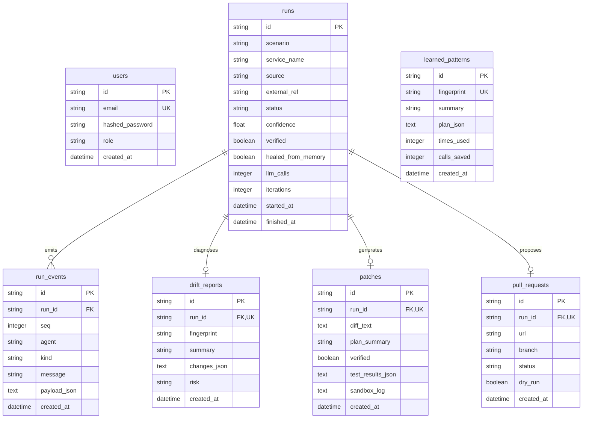

# DriftSmith Database Architecture

DriftSmith persists remediation history, timeline event logs, generated patches, and learned patterns using SQLAlchemy 2.0 and Alembic. By default, it operates on a zero-config local SQLite database (`backend/data/driftsmith.db`), and seamlessly connects to PostgreSQL in production environments simply by updating `DATABASE_URL`.

---

## Entity-Relationship Diagram

---

## Table Notes & Plain-English Purpose

### 1. `users`
- **Purpose:** Stores registered user accounts with role-based permissions (`viewer`, `approver`, `admin`).
- **Security:** Passwords are never stored in plaintext; they are salted and hashed with bcrypt.
- **Seeded Accounts:** Default identities (`admin@demo.local`, `approver@demo.local`, `viewer@demo.local`) are initialized via `seeds/seed_demo_users.py`.

### 2. `runs`
- **Purpose:** The central remediation record representing an attempt to heal an API drift incident.
- **Fields:**
  - `scenario`: The drift pattern (`"rename"`, `"type"`, `"nested"`).
  - `source`: The trigger source (`"manual"`, `"webhook"`, `"ci"`, `"n8n"`).
  - `external_ref`: Correlation ID from external orchestration systems (e.g. n8n execution ID or Slack thread ID).
  - `status`: Lifecycle phase (`"queued"`, `"running"`, `"verified"`, `"failed"`, `"awaiting_approval"`, `"approved"`, `"rejected"`).
  - `healed_from_memory`: True when a previously learned fix was applied with zero LLM inference calls.
  - `llm_calls`: Number of LLM invocations incurred during the run.

### 3. `run_events`
- **Purpose:** An append-only event log capturing every agent thought, observation, action, and sandbox verification output in strict sequence (`seq`).
- **Resilience:** Events are persisted immediately so the browser UI timeline survives server restarts and page reloads. Streamed live over Server-Sent Events (SSE).

### 4. `drift_reports`
- **Purpose:** Structured output from the Sentinel and Triage agents diagnosing which fields drifted and evaluating operational risk (`low`, `medium`, `high`).
- **Relationship:** One-to-one relationship with `runs`.

### 5. `patches`
- **Purpose:** Captures the unified code diff produced by the Coder agent along with sandboxed verification test outputs for both old and new payload versions.
- **Contract Guarantee:** Contains `test_results` verifying that the service remains backward compatible with old payloads and succeeds on new ones.

### 6. `pull_requests`
- **Purpose:** Manages the GitHub Pull Request lifecycle.
- **Safety Guarantee:** Always created in `dry_run` preview mode initially. Actual GitHub PRs are only created after an authorized human (`approver` or `admin`) explicitly clicks Approve.

### 7. `learned_patterns`
- **Purpose:** Memory storage for learned fixes.
- **Zero-Inference Healing:** When a drift matches an existing `fingerprint`, the stored `PatchPlan` is applied and verified immediately, saving 100% of LLM calls (`calls_saved`).
